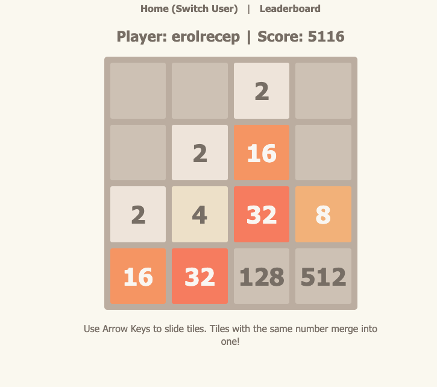

# 🚀 Vibe Coding Workshop: Building at the Speed of Thought

[](https://erolrecep.github.io/VibeCoding-Workshop/)
[](https://www.python.org/)
[](https://docs.astral.sh/uv/)
[](https://flask.palletsprojects.com/)
[](https://pkg.go.dev/golang.org/x/tools/cmd/present)
[](LICENSE)

Welcome to the **Vibe Coding Workshop** repository! This workshop introduces a modern paradigm of software creation: shifting focus from writing low-level syntax to steering state-of-the-art AI models through structured prompting, iterative reasoning, and rapid validation.

---

> *"There's a new kind of coding I call 'vibe coding', where you entirely give up the wheel to the AI and just speak your intent, copy-paste error messages, and guide the model."*  
> — **Andrej Karpathy**

---

## 👨‍🏫 Instructor

**Recep Erol, PhD**  
*Computational Scientist for AI*  
[Center for Research and Computing (CRC)](https://researchcomputing.rice.edu/), Rice University  

- 💼 **LinkedIn**: [linkedin.com/in/erolrecep](https://linkedin.com/in/erolrecep)
- 🐙 **GitHub**: [@erolrecep](https://github.com/erolrecep)
- 🌐 **Website**: [erolrecep.github.io](https://erolrecep.github.io)

---

## 🖥️ Presentation Slides

You can access and deliver the workshop presentation both online and offline.

### 🌐 View Online (Any Device)
The interactive slide deck is automatically built and deployed to GitHub Pages:  
👉 **[Launch Online Presentation](https://erolrecep.github.io/VibeCoding-Workshop/)**

---

### 💻 Run Slides Locally

#### Method 1: Using Go `present` (Native)
The presentation is authored in Go's native `.slide` format ([`vibecoding.slide`](file:///Users/erolrecep/Developer/codebase/apps/VibeCoding-Workshop/vibecoding.slide)). You can run it with Go's `present` tool:

```bash
# Run present directly (Go 1.18+ required)
go run golang.org/x/tools/cmd/present@latest -notes -play=false
```

Then open your browser to [http://localhost:3999/vibecoding.slide](http://localhost:3999/vibecoding.slide).

*Slide Presentation Controls:*
- `Right Arrow` / `Space` : Next slide
- `Left Arrow` : Previous slide
- `N` : Toggle presenter notes
- `W` : Toggle widescreen layout
- `Ctrl +` / `Ctrl -` : Adjust font scaling

#### Method 2: Using Docker Container
Run the self-contained Go `present` container without needing Go installed locally:

```bash
docker build -t vibecoding-slides .
docker run -p 3999:3999 vibecoding-slides
```
Open [http://localhost:3999/vibecoding.slide](http://localhost:3999/vibecoding.slide).

#### Method 3: Export to Standalone Static HTML
Generate a fully offline, self-contained HTML/JS/CSS bundle with one script:

```bash
chmod +x scripts/export_slides.sh
./scripts/export_slides.sh public

# Preview exported site
python3 -m http.server 8000 -d public
```

---

## 🎮 Hands-On Demo: 2048 Python Web App

The repository includes a complete, production-ready **2048 Game** created through prompt engineering. It demonstrates full-stack web development with SQLite user persistence, auto-save state synchronization, and leaderboards.



### ⚡ 60-Second Quickstart with `uv`

[`uv`](https://docs.astral.sh/uv/) is Astral's ultra-fast Python package and project manager. It handles virtual environments, Python binaries, and dependencies automatically without manual activation.

```bash
# Clone the repository (if you haven't already)
git clone https://github.com/erolrecep/VibeCoding-Workshop.git
cd VibeCoding-Workshop/2048

# Run directly with uv
uv run python app.py
```

*The Flask server starts and automatically launches your browser at `http://127.0.0.1:5000/`.*

### 🛠️ Run via `make`

If you have `make` installed:

```bash
cd 2048
make run
```
*(The Makefile detects whether `uv` is installed and uses it; otherwise, it sets up a standard Python virtual environment automatically).*

For detailed architecture, database schema, and customization challenges, see the **[2048 App README](file:///Users/erolrecep/Developer/codebase/apps/VibeCoding-Workshop/2048/README.md)**.

---

## 📋 Workshop Agenda

1. **What is Vibe Coding?**
   - Redefining the software engineer's role: Architect & Reviewer.
   - Zero domain knowledge barriers: Exploring Rust, WebGL, or Web Apps with AI.
   - The feedback loop: Rapid iteration, debugging with stack traces, guided refinement.
2. **How It Works: The Triad**
   - **Prompt**: Formulating structured intent.
   - **Model**: Multi-modal LLMs, Mixture-of-Experts (MoE), coding specialists.
   - **Output**: Binaries, full applications, scripts, tests.
3. **Anatomy of an Effective Prompt**
   - **Persona / Role**: Establishing tone and expertise domain.
   - **Task / Goal**: Explicit definition of what to build.
   - **Context**: Tech stack constraints, background data, user expectations.
   - **Constraints & Guardrails**: Negative constraints, performance bounds, zero-friction running requirements.
   - **Few-Shot Examples**: Guiding response style and code structure.
4. **LLM Models & Compute Landscape**
   - Training vs. Fine-tuning vs. Real-time Inference.
   - Local LLM inference (LM Studio, Ollama) vs. Cloud APIs (Gemini, Claude, OpenAI).
   - Compute infrastructure & data centers.
5. **Sample Project Walkthrough: 2048 Web App**
   - Deconstructing the prompt that generated the game.
   - Architectural decisions made by the LLM (Flask, SQLite, vanilla frontend, Make lifecycle).
6. **Interactive Challenge: Vibe Code Together!**
   - Live prompt challenge: From blank editor to working software in 15 minutes.
7. **Q&A and Next Steps**

---

## 📁 Repository Structure

```
VibeCoding-Workshop/
├── .github/
│   └── workflows/
│       └── deploy-slides.yml   # Automated GitHub Pages CI/CD workflow
├── .gitignore                  # Git exclusions for Python, DB, and builds
├── Dockerfile                  # Container definition for Go present slides
├── Makefile                    # Root helper (optional)
├── README.md                   # Main workshop documentation (this file)
├── about_me.html               # Presenter bio snippet embedded in slides
├── vibecoding.slide            # Go present presentation source
├── images/                     # Workshop illustrations and screenshots
│   ├── 2048.png
│   ├── avatar.jpeg
│   ├── datacenter.jpg
│   ├── karpathy_tweet.png
│   ├── llm_models_info.png
│   └── prompt_flow.png
├── scripts/
│   └── export_slides.sh        # Static slide exporter script
└── 2048/                       # Sample Python web application
    ├── README.md               # Detailed 2048 & uv documentation
    ├── app.py                  # Flask application & database logic
    ├── pyproject.toml          # uv / packaging specification
    ├── requirements.txt        # Classic pip dependencies
    ├── Makefile                # Lifecycle commands (run, run-uv, clean)
    ├── src/2048/__init__.py    # CLI entrypoint
    ├── templates/              # Jinja2 HTML templates
    └── static/                 # Stylesheet & game engine JavaScript
```

---

## 🚢 Continuous Deployment to GitHub Pages

This repository is configured with a GitHub Actions workflow ([`.github/workflows/deploy-slides.yml`](file:///Users/erolrecep/Developer/codebase/apps/VibeCoding-Workshop/.github/workflows/deploy-slides.yml)) that:
1. Triggers on any push to `main` that touches presentation files.
2. Compiles the Go `present` deck into static HTML, JS, and CSS.
3. Automatically publishes the bundle to **GitHub Pages**.

### Enabling GitHub Pages in Your Fork / Repo:
1. Go to your repository settings: **Settings** -> **Pages**.
2. Under **Build and deployment** -> **Source**, select **GitHub Actions**.
3. Push to `main` or trigger the workflow manually from the **Actions** tab.

---

## 📜 License

This workshop material and source code are released under the [MIT License](LICENSE).
